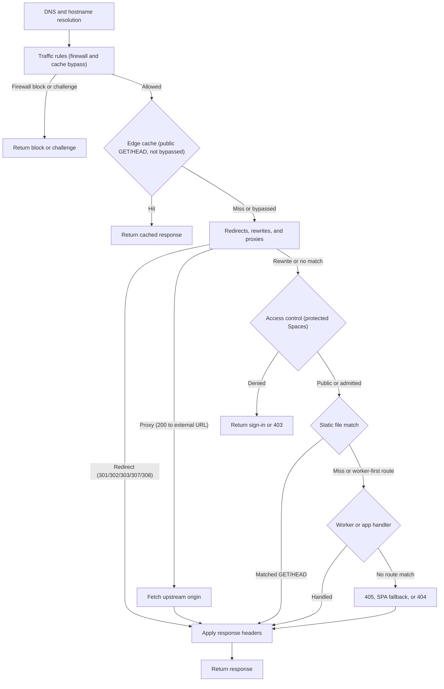

Spacefast evaluates DNS, edge traffic rules, edge cache, routing rules, static files, and dynamic handlers in a fixed order. Response headers apply on the way out. Knowing this order tells you which rule wins when two features match the same URL.

## DNS and hostname resolution

DNS routes your custom domain or `space.fast` hostname to Spacefast's edge, which maps it to a Space and target version (live, immutable version, or branch preview). Host-level redirects, such as `www` to the apex domain, run here before Spacefast evaluates Space content. See [Custom domains](/domains) and [URLs and hostnames](/urls).

## Traffic rules

Firewall rules evaluate first at the edge and can `block` or `challenge` a request before it reaches your Space. Edge traffic protection can also return HTTP `429` for excessive visitor traffic; see [Rate limiting](/infrastructure/rate-limiting) (management API calls follow a separate budget returning [`rate_limited`](/errors/rate_limited)). Cache-bypass rules decide whether a request skips the edge cache and goes straight to the Space. When you enable edge placement (`placement.edge`), eligible redirects and headers also run at the edge. See [Redirects and rewrites](/redirects).

## Edge cache

For public `GET` and `HEAD` requests that no cache-bypass or no-store rule excludes, the edge checks its shared cache, keyed on host, path, and query string. A hit returns immediately, including `304` answers to conditional `ETag` requests. Protected Spaces, non-`GET`/`HEAD` requests, share-link tokens, and URLs touched by conditional routing rules skip shared caching. See [Caching](/caching).

## Redirects, rewrites, and proxies

On a cache miss, Spacefast evaluates compiled rules in order (`_redirects` first, then `redirects`, then `rewrites` from [`spacefast.config.ts`](/config-file) or `sf.jsonc`), and the first match wins. Redirects and proxies answer without checking the static file table. Rewrites and `404` rules yield to an existing static file unless you set `force`. Test rule evaluation locally before publishing with [`sf routing inspect`](/cli/reference#sf-routing-inspect), and see [Redirects and rewrites](/redirects).

## Access control

On protected Spaces, Spacefast checks grants (team membership, invited people, share links, passwords, or SSO) before serving files, proxies, storage, or dynamic handlers. Checks run against both the requested path and any rewritten destination. Public Spaces skip this step. See [Share and access](/share).

## Static file match

Spacefast looks up the effective path in the version's published file table, applying clean URLs and folder `index.html` resolution. Unless a Worker route runs ahead of static assets, a matching file answers `GET` and `HEAD` directly. Requests with another HTTP method against an existing static path record `Allow` so Spacefast returns `405` instead of `404` if nothing else handles them. See [Publishing](/publish) and [Redirects and rewrites](/redirects).

## Worker and app handler

If no static file answered (or a route runs worker-first), Spacefast dispatches matching paths to the Space's app handler or Worker (`functions/`, a root `handler.ts`, or a framework worker). Dynamic routes receive the standard `Request` and return a `Response`, with access to environment variables, database, and connectors. See [Workers](/functions) and [Build](/build).

## Method check, SPA fallback, and 404

If a static file or Worker route matched the path for a different HTTP method, Spacefast returns `405 Method Not Allowed` with an `Allow` header. Otherwise, non-asset misses serve the configured or inferred SPA fallback (`200`), or walk upward from the request directory for the nearest `404.html`. If none exists, Spacefast renders its default `404` page. See [Customization and error pages](/customization).

## Response headers

On the way out, Spacefast applies every matching header rule from dashboard settings, [`spacefast.config.ts`](/config-file#redirects-rewrites-headers-and-traffic-rules) (or `sf.jsonc`), and `_headers`, matched against the visitor's original request path rather than a rewritten path. Spacefast attaches default `Cache-Control` and `ETag` headers here unless your rules override them. See [Response headers](/headers) and [Caching](/caching).
